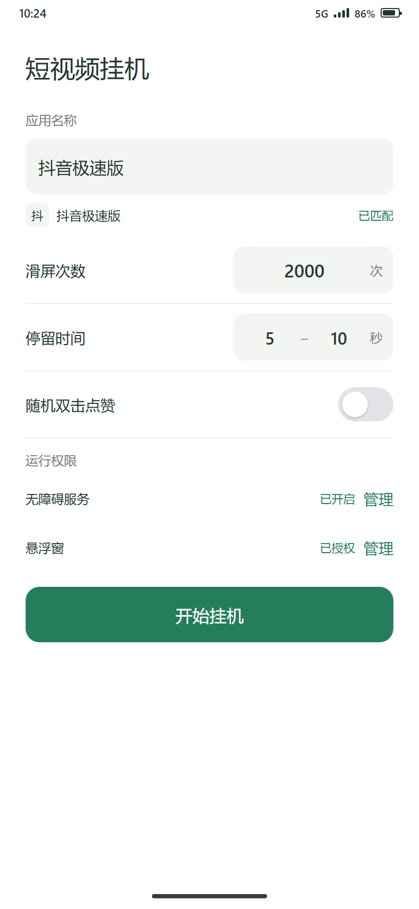
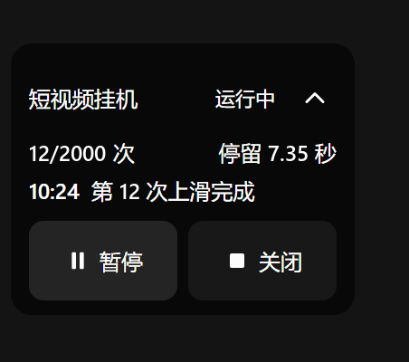

# 短视频挂机

Android 本地自动滑屏工具：填写手机上的应用名称，设置上滑次数与随机停留时间，通过悬浮窗暂停、继续或关闭任务。

支持 **Android 10（API 29）及以上的 ARM64 设备**。

> **主要用于学习与个人设备自动化测试。** 自动上滑、自动双击可能违反目标应用的服务条款并带来账号风险，详见[免责声明](#免责声明)。

## 界面预览

|                             主设置页                            |                              悬浮窗                              |
| :---------------------------------------------------------: | :-----------------------------------------------------------: |
|  |  |

界面示意：按源码布局参数还原，非真机截图；动图中的触点用于演示点击。可用真机截图替换 docs/ 下的同名文件。

## 当前功能

- 按名称匹配手机中已安装且可启动的应用；存在多个匹配结果时手动选择，不固定目标包名。
- 打开目标应用后固定等待 10 秒，再开始按停留时间循环上滑。
- 每轮停留时长在设定范围内按毫秒随机抽取；上下限相同时使用固定时长。
- 单次上滑手势时长随机为 1–100 毫秒，手势位置根据屏幕可用区域计算，并避开本应用悬浮窗。
- 可选随机双击点赞；每轮按设定概率决定是否在停留期间执行双击。
- 黑色半透明、白字悬浮窗，每次新任务默认在屏幕左侧中部展开，可在本次任务中拖动、收起和展开；收起／展开状态不保存。窗口显示运行状态、完成次数、本轮停留时间和最新运行提示。
- 主设置页跟随系统切换浅色或深色模式，采用绿色强调色；应用图标为“哈基伟”，支持自适应及单色主题图标。

## 权限与使用

1. 安装应用，在主设置页手动开启无障碍服务和“显示在其他应用上层”。授权后返回应用，授权本身不会启动任务。
2. 填写应用名称，确认匹配结果，设置上滑次数、停留时间和可选的点赞概率。
3. 点击“开始挂机”，应用会打开所选目标。在 10 秒启动等待期间进入需要操作的页面；等待结束后，每轮先停留再上滑。
4. 通过主设置页或悬浮窗控制同一个任务。使用时保持屏幕点亮、解锁，并让需要操作的页面位于前台。

| 操作或状态   | 行为                                    |
| ------- | ------------------------------------- |
| 暂停      | 暂停后续手势，保留本次进度和剩余等待时间                  |
| 运行中切换应用 | 当前操作的应用离开前台后暂停，切回后自动继续                |
| 继续      | 在当前前台应用中继续同一个任务；可以切换操作对象，不会自动打开原应用    |
| 关闭      | 结束任务、清空本次进度并关闭悬浮窗                     |
| 达到次数上限  | 停止上滑，保留悬浮窗显示完成结果；可点击“关闭”，或回到主设置页开始新任务 |

手动暂停、熄屏、锁屏、权限关闭或服务中断后，需要恢复相应条件并手动继续。点击“继续”时，应先切到要操作的应用，再使用悬浮窗按钮。

应用只检查前台应用和可用操作区域，不识别视频画面、页面文字、输入框或弹窗。上滑次数和点赞次数分别按系统确认完成的上滑、双击手势统计，不读取目标应用的实际点赞状态。已经提交给系统的短手势可能在暂停或关闭后完成，后续操作会取消。

## 隐私与数据

- **无网络权限**：APK 未声明 `android.permission.INTERNET`，应用无法发起网络请求，也不包含统计、广告或崩溃上报 SDK。
- **只读必要信息**：无障碍服务仅读取前台应用的包名、窗口边界和屏幕可用区域，用于判断目标应用是否在前台、手势应落在哪里；不解析、不保存页面文字、输入内容或节点树。
- **配置只存本机**：应用名称、次数、停留时间等设置保存在应用私有目录的 DataStore 中；`allowBackup="false"`，`data_extraction_rules.xml` 全部排除，不参与云备份和换机迁移。
- **运行数据不落盘**：任务进度、点赞计数和最新日志只存在内存，关闭任务或退出进程即丢失。
- **权限可随时收回**：在系统设置中关闭无障碍服务或“显示在其他应用上层”，应用会立即暂停或停止。
- 可自行核对：[AndroidManifest.xml](app/src/main/AndroidManifest.xml)、[data\_extraction\_rules.xml](app/src/main/res/xml/data_extraction_rules.xml)、[ScreenInspector.kt](app/src/main/java/com/shortvideo/autoswipe/accessibility/ScreenInspector.kt)。

## 编程语言与构建工具

| 类别           | 名称与版本                          | 用途                     |
| ------------ | ------------------------------ | ---------------------- |
| 应用编程语言       | Kotlin 2.4.21                  | 编写 Android 应用与构建配置     |
| 界面框架         | Jetpack Compose，BOM 2026.09.00 | 绘制主页面与悬浮窗内容            |
| 设置存储         | DataStore Preferences 1.3.0    | 异步保存本机设置               |
| 异步任务         | Kotlin Coroutines 1.11.0       | 执行等待、手势调度及状态更新         |
| 构建工具         | Gradle 9.8.2                   | 管理编译、依赖和打包任务           |
| Android 构建插件 | AGP 9.5.1                      | 编译和打包 Android 应用       |
| Java 开发工具    | JDK 27（Temurin）                | 运行构建工具；应用字节码目标为 JVM 17 |
| Android 编译平台 | SDK Platform 37.2              | 提供 Android 系统接口        |
| Android 打包工具 | Build Tools 37.0.0             | 处理资源、签名及安装包            |
| 单元测试         | JUnit 6.1.3                    | 检查任务控制、手势及参数逻辑         |

应用源码使用 Kotlin，主页面与悬浮窗内容使用 Jetpack Compose 构建。悬浮窗由 ComposeView 和 WindowManager 承载，滑动与双击等手势由 AccessibilityService 配合协程执行。

依赖版本集中在 [gradle/libs.versions.toml](gradle/libs.versions.toml)。发布版开启 R8 代码压缩、混淆和资源裁剪，压缩 DEX，仅保留 ARM64 原生库及简体中文资源。

## 项目结构

| 文件或目录                                               | 中文说明                              |
| --------------------------------------------------- | --------------------------------- |
| app/                                                | 手机软件的主体                           |
| app/src/main/java/                                  | Kotlin 功能代码，包括设置页、悬浮窗和自动滑屏        |
| app/src/main/res/                                   | 手机软件使用的图标、文字等资源                   |
| app/src/test/                                       | 检查功能逻辑的测试代码                       |
| app/build.gradle.kts                                | 应用版本、SDK 要求、依赖、APK 命名和签名规则        |
| design/icon/                                        | 哈基伟图标的 SVG 原稿和 PNG 图片             |
| docs/                                               | README 使用的界面示意图与动图                |
| gradle/                                             | 构建工具版本、依赖版本和 Wrapper 文件           |
| gradlew、gradlew.bat                                 | 构建启动入口；Windows 使用 gradlew.bat     |
| build.gradle.kts、settings.gradle.kts                | 项目的构建配置                           |
| gradle.properties                                   | 构建参数，包含 Windows 中文目录设置            |
| .github/workflows/build.yml                         | Release 构建、检查及 GitHub Releases 发布 |
| .gitignore                                          | 本机配置、签名材料和构建产物的忽略规则               |
| README.md                                           | 本说明文件                             |
| LICENSE                                             | 本项目的 Apache-2.0 开源许可证             |

## 免责声明

- 本项目主要用于学习 Android 无障碍服务、悬浮窗与协程调度，以及在个人设备上进行自动化测试。
- 自动上滑、自动双击等操作可能违反目标应用的用户协议，可能导致功能限制、限流或账号封禁；是否使用及由此产生的后果由使用者自行承担。
- 请遵守所在地法律法规与目标应用的服务条款，不要用于刷量、营销、虚假互动或其他违规用途。
- 应用不修改目标应用、不注入代码、不抓取页面内容，仅通过系统无障碍接口模拟手势。
- 本项目按 [Apache-2.0](LICENSE) 提供，不对可用性、合规性或特定用途适用性作任何担保。
